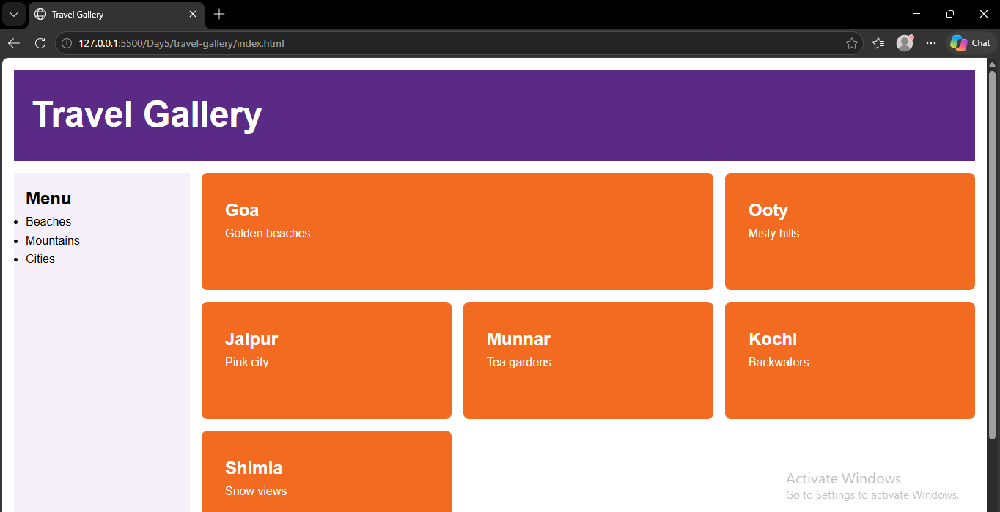

# Travel Gallery

A responsive travel gallery showcasing beautiful destinations across India.

## Screenshot

## Features

- Responsive layout for mobile, tablet and desktop.
- CSS Grid-based page layout.
- Featured destination card.
- Sidebar navigation menu.
- Clean and simple design.

## Technologies Used

- HTML5
- CSS3
- CSS Grid
- Media Queries

## How to Run

1. Download or clone this repository.
2. Open the project folder.
3. Open `index.html` in your browser.
4. Alternatively, use VS Code Live Server.

## Author

Sadhatchi S.S

GitHub: https://github.com/sadhatchi